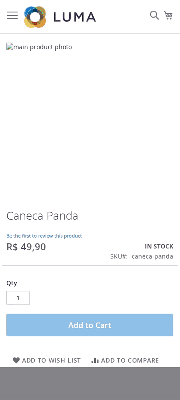
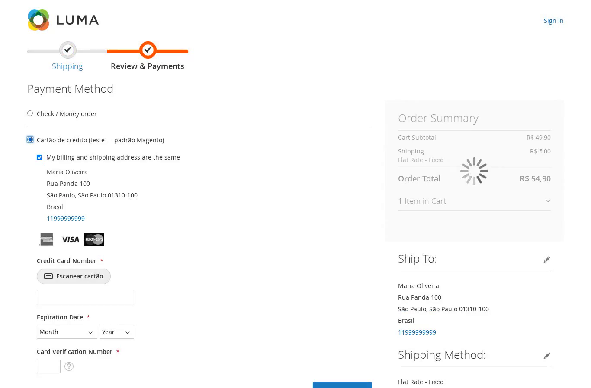
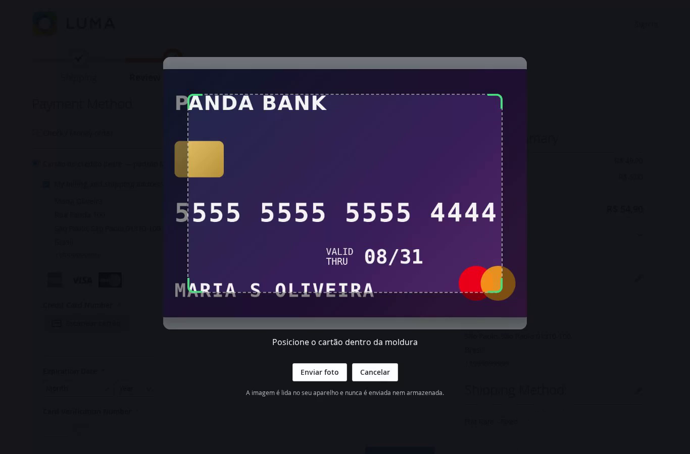
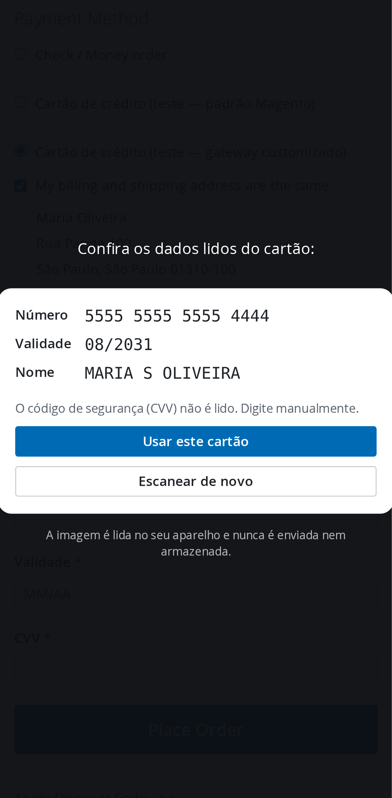
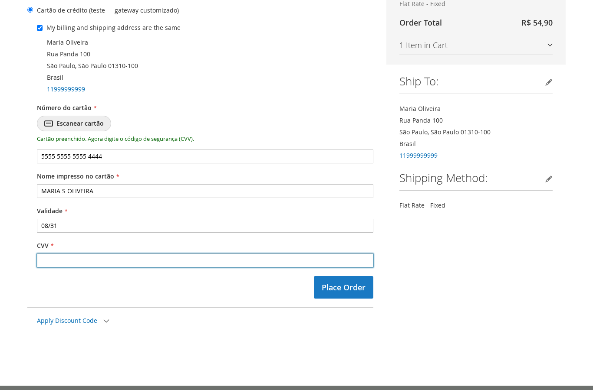

# Magento 2 Card Scanner

Escaneie o cartão de crédito pela câmera no checkout do Magento 2. O número, a validade e o nome são
preenchidos sozinhos em **qualquer método de pagamento** que mostre os campos de cartão na página.

A leitura (OCR) acontece **no navegador do cliente**. A imagem do cartão não é enviada nem armazenada.

<p align="center">
  
</p>

## Como funciona

1. Na etapa de pagamento, o módulo procura campos de cartão no método escolhido. Quando encontra,
   coloca o botão **"Escanear cartão"** acima do número.
2. O cliente toca no botão. A câmera abre com uma moldura no formato do cartão. Sem câmera (ou
   no desktop), o cliente pode enviar uma foto.
3. O [Tesseract.js](https://github.com/naptha/tesseract.js) lê os quadros da câmera dentro do
   navegador. Os arquivos do OCR (~7 MB) ficam hospedados no próprio módulo e só baixam no primeiro
   clique.
4. O texto lido passa por um parser que:
   - junta os grupos de dígitos como vêm impressos (4-4-4-4, 4-6-5 do Amex) e corrige trocas
     típicas do OCR (`O`→`0`, `l`→`1`, `S`→`5`…);
   - só aceita o número se ele passar no **algoritmo de Luhn** e aparecer igual em **2 quadros
     seguidos**;
   - escolhe a validade futura mais distante (ignora "membro desde");
   - acha o nome impresso, descartando bandeira, banco e rótulos.
5. O cliente confere os dados e toca em **"Usar este cartão"**. Os campos são preenchidos e o
   cursor vai para o CVV, que é sempre digitado à mão.

| 1. Botão no checkout | 2. Câmera com moldura |
|---|---|
|  |  |

| 3. Conferência (celular) | 4. Campos preenchidos (gateway customizado) |
|---|---|
|  |  |

Vídeo no desktop: [docs/demo-desktop.mp4](docs/demo-desktop.mp4)

## Por que funciona com qualquer método de pagamento

O módulo não depende de um gateway específico. Ele observa o checkout e classifica os campos de
cada método por:

- `autocomplete` (`cc-number`, `cc-exp`, `cc-name`…);
- `name`, `id` e `data-*` (`payment[cc_number]`, `cardNumber`, `numero_cartao`, `card_holder`…);
- placeholder e label ("Número do cartão", "MM/AA", "Nome impresso no cartão");
- conteúdo dos `<select>` (12 opções de mês, lista de anos).

Ele também evita os campos do endereço de cobrança, CPF e parcelas.

Na hora de preencher, o valor é escrito como se o cliente tivesse digitado (eventos `input`,
`change`, `keyup`, `blur`). Assim o Knockout, as máscaras jQuery e os componentes React do gateway
atualizam normalmente. A validade se adapta ao campo:

- `<select>` de mês/ano com valores `1`, `01` ou `2031`;
- campo único `MM/AA`, `MM/AAAA` ou `MMAA`, conforme o placeholder e o `maxlength`.

Testado com:

- o **cc-form padrão do Magento** (`Magento_Payment`): validade em selects, bandeira detectada
  automaticamente;
- um **gateway com campos próprios**: número com máscara, nome do titular e validade "MM/AA" num
  campo só.

### Onde não funciona (e nenhum módulo consegue)

- **Campos dentro de iframe do gateway** (Braintree Hosted Fields, Stripe Elements, Adyen e
  parecidos). O navegador bloqueia o acesso a iframes de outro domínio. Isso é proposital, faz
  parte da segurança PCI desses gateways.
- **Pagamento por redirecionamento**, em que o cartão é digitado no site do gateway.

## Privacidade e segurança

- A imagem da câmera nunca sai do aparelho. Não há requisição com a foto nem com os dados lidos.
- O CVV não é lido.
- O módulo não guarda nada. Ele só preenche campos que o cliente já preencheria digitando.
- Com a opção de autocomplete ativa, os campos ganham `autocomplete="cc-number"`, `cc-exp` etc.
  Isso também libera o **scan nativo** do Safari (iOS) e do Chrome (Android).

## Requisitos

- Magento Open Source / Adobe Commerce 2.4.x. Testado no **2.4.9** com PHP 8.5.
- **HTTPS** na loja: o navegador só libera a câmera em HTTPS (ou em `localhost`).
- Funciona com a CSP restrita do checkout do 2.4.7+: o worker do OCR é servido como arquivo
  estático, sem `blob:`.

## Instalação

Via Composer:

```bash
composer require rodrigocardoso/module-card-scanner
bin/magento module:enable MagePanda_CardScanner
bin/magento setup:upgrade
bin/magento setup:di:compile            # em produção
bin/magento setup:static-content:deploy # em produção
bin/magento cache:flush
```

Manual: copie o conteúdo deste repositório para `app/code/MagePanda/CardScanner/` e rode os mesmos
comandos a partir do `module:enable`.

## Configuração

**Lojas › Configuração › Vendas › Escanear cartão**

| Opção | Padrão | O que faz |
|---|---|---|
| Ativo | Sim | Liga/desliga o botão. |
| Mostrar no desktop | Sim | No desktop o cliente usa a webcam ou envia uma foto. Com "Não", o botão aparece só em telas touch. |
| Somente nestes métodos | (todos) | Limita o botão a alguns métodos. Vazio = todos os métodos onde houver campos de cartão. |
| Ativar autocomplete nativo | Sim | Marca os campos com `autocomplete="cc-*"`. |
| Texto do botão | "Escanear cartão" | Personaliza o texto. |

Traduções: `pt_BR` incluída, com textos-base em inglês.

## Limitações

- A precisão do OCR é ótima em cartões com número **impresso liso**, que são a maioria hoje. Em
  números em **relevo** prateado, com reflexo ou pouca luz, a leitura demora mais ou falha. O
  cliente sempre confere e pode corrigir à mão.
- Os testes automatizados usaram uma câmera simulada com a imagem de um cartão. Ainda não houve
  teste extenso com cartões físicos de vários bancos. Feedback e PRs são bem-vindos.

## Testes

```bash
# parser e classificação de campos (Node 18+)
node --test Test/Js/*.test.js

# PHP (dentro de uma instalação Magento)
vendor/bin/phpunit -c dev/tests/unit/phpunit.xml.dist app/code/MagePanda/CardScanner/Test/Unit
```

## Estrutura

```
view/frontend/web/js/
  card-parser.js     número (Luhn + votos entre quadros), validade, nome, bandeira
  field-matcher.js   classifica campos de qualquer gateway e formata os valores
  ocr.js             Tesseract.js local, pré-processamento da imagem
  scanner.js         tela da câmera, moldura, envio de foto, confirmação
  view/card-scanner.js  observa o checkout, injeta o botão e preenche os campos
Model/               configuração e window.checkoutConfig
```

## Licença

[MIT](LICENSE) © Rodrigo Cardoso.

O Tesseract.js e o `eng.traineddata` em `view/frontend/web/vendor/tesseract/` são
distribuídos sob a Apache License 2.0.
